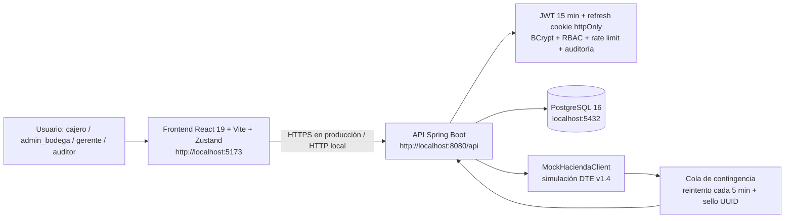

# Daash ERP & DTE — MVP

Sistema integral de gestión comercial y facturación electrónica para **Adventure Works**, desarrollado por **Daash Devs** en el marco de **Práctica Profesional II** (Universidad Centroamericana "José Simeón Cañas", UCA).

## Visión

Proveer una plataforma web única para operación de punto de venta, inventario, clientes, proveedores, compras, caja, reportería y **Documentos Tributarios Electrónicos (DTE)**, con seguridad integrada desde el diseño (DevSecOps): autenticación JWT, autorización por roles, auditoría, cabeceras HTTP de protección, análisis estático y escaneo de dependencias en CI.

El MVP prioriza la **integridad de las operaciones financieras**: el backend es la única fuente de verdad para precios, subtotales, IVA y totales, incluso cuando el cliente intenta alterar el payload. El módulo de compras genera un **crédito fiscal en PDF** con diseño corporativo, marca de agua de simulación y **código QR** con los datos firmados; lo persiste para consulta/descarga en la aplicación y lo envía por **SMTP real configurable** al correo del cliente configurado en la compra.

> **Alcance fiscal:** El DTE es una **simulación formal** conforme al contrato JSON **v1.4**, con firma JWT HS256 mediante `DTE_SIGNING_SECRET` y un `MockHaciendaClient` que emula éxito/fallo. **No existe integración real con el Ministerio de Hacienda de El Salvador** y la firma simulada no sustituye un certificado digital emitido por la autoridad tributaria. La cola de contingencia y su reintento automático demuestran el comportamiento requerido ante caída del servicio fiscal.

## Arquitectura



- **Frontend:** React 19 + TypeScript + Vite + Tailwind CSS + Zustand. El access token vive solo en memoria (`src/lib/api.ts`); el refresh token viaja en cookie `httpOnly`.
- **Backend:** Java 25 + Spring Boot 4.x (compatible con la línea 3.5+) + Maven Wrapper en `backend/mvnw`.
- **Persistencia:** PostgreSQL 16, JPA/Hibernate con consultas parametrizadas.
- **Seguridad:** filtros JWT, BCrypt, RBAC por endpoint, limitación de intentos, cabeceras CSP/HSTS/X-Frame-Options, `AuditLog`.
- **Evidencia:** pruebas JUnit/MockMvc, Semgrep, Trivy, script `scripts/security-scan.sh` y workflow `.github/workflows/ci.yml`.

El contrato de API completo está en [`docs/API_CONTRACT.md`](docs/API_CONTRACT.md) y el plan de implementación en [`docs/MVP_IMPLEMENTATION_PLAN.md`](docs/MVP_IMPLEMENTATION_PLAN.md).

## Stack

| Capa | Tecnología |
|---|---|
| Cliente | React 19, TypeScript, Vite 8, Tailwind CSS 4, Zustand 5, React Router 7 |
| Servidor | Java 25, Spring Boot 4.x, Spring Security, Spring Data JPA, JJWT 0.12, Spring Mail, OpenPDF |
| Datos | PostgreSQL 16 (H2 solo en pruebas) |
| Contenedores | Docker + Docker Compose |
| Seguridad / calidad | Semgrep (SAST), Trivy (SCA/secretos/misconfig), OWASP ZAP (DAST opcional), Oxlint |
| CI | GitHub Actions (jobs `backend`, `frontend`, `security`) |

## Requisitos previos

- **JDK 25** (para ejecutar el backend y el Maven Wrapper; no se instala globalmente desde este repositorio).
- **Docker** con **Docker Compose** (para PostgreSQL, backend y frontend).
- **Node.js 20+** y npm (para build/lint del frontend).
- Opcionales: **Trivy** y **Semgrep** para los escaneos locales. El script y la CI avisan si faltan; Semgrep no es bloqueante en local.

## Instalación y ejecución

1. Clonar el repositorio y ubicarse en la raíz del proyecto.
2. Crear el archivo de entorno a partir de la plantilla:

   ```bash
   cp .env.example .env
   ```

   Revisar especialmente `POSTGRES_PASSWORD`, `JWT_SECRET`, `REFRESH_SECRET` y `DTE_SIGNING_SECRET`. **Nunca versionar `.env`**; la plantilla `.env.example` no contiene secretos reales.

   ### Correo de facturas de compra

   La entrega por correo es opcional y se activa al definir `MAIL_HOST` en `.env`:

   | Variable | Descripción | Valor por defecto |
   |---|---|---|
   | `MAIL_HOST` | Servidor SMTP. Vacío = modo simulado (PDF disponible en la app). | vacío |
   | `MAIL_PORT` | Puerto SMTP. | `587` |
   | `MAIL_USER` / `MAIL_PASSWORD` | Credenciales SMTP. | vacíos |
   | `MAIL_AUTH` / `MAIL_STARTTLS` / `MAIL_SSL` | Banderas de autenticación/TLS. | `true` / `true` / `false` |
   | `MAIL_FROM` | Remitente del correo. | `no-reply@daash.local` |
   | `COMPANY_NAME`, `COMPANY_NIT`, `COMPANY_NRC`, `COMPANY_ADDRESS` | Datos del receptor que aparecen en el crédito fiscal. | Adventure Works |

   Ejemplo para Gmail (usa una *app password*, nunca la contraseña personal):

   ```dotenv
   MAIL_HOST=smtp.gmail.com
   MAIL_PORT=587
   MAIL_USER=tu-cuenta@gmail.com
   MAIL_PASSWORD=tu-app-password
   MAIL_FROM=tu-cuenta@gmail.com
   ```

   Si el envío falla, la compra queda registrada con `emailEstado=FALLIDO`, el motivo visible en la fila y el botón de reenvío disponible para `admin_bodega`/`gerente`.

3. Levantar los tres servicios:

   ```bash
   docker compose up -d --build
   ```

4. Verificar que estén `healthy`:

   ```bash
   docker compose ps
   curl http://localhost:8080/api/health
   curl http://localhost:5173/api/health
   ```

5. Acceder a:

   | Servicio | URL |
   |---|---|
   | Frontend | <http://localhost:5173> |
   | API (base) | <http://localhost:8080/api> |
   | Health check | <http://localhost:8080/api/health> |
   | PostgreSQL | `localhost:5432` (base `daash`, usuario `daash`) |

### Usuarios demo

| Email | Contraseña | Rol |
|---|---|---|
| `maria@adventureworks.com` | `Demo1234!` | `cajero` |
| `carlos@adventureworks.com` | `Demo1234!` | `admin_bodega` |
| `ana@adventureworks.com` | `Demo1234!` | `gerente` |
| `roberto@adventureworks.com` | `Demo1234!` | `auditor` |

> El acceso rápido del frontend **rellena únicamente el email**; la contraseña nunca se muestra ni se almacena en el cliente. Las contraseñas se guardan con BCrypt en PostgreSQL.

## Build, pruebas y escaneo

```bash
# Backend (el wrapper está en backend/, NO en la raíz)
cd backend && ./mvnw verify
cd ..

# Frontend (desde la raíz)
npm ci
npm run build
npm run lint

# Paquete completo de evidencia (escribe evidence/*.log y evidence/summary.txt)
./scripts/security-scan.sh
```

El script `scripts/security-scan.sh` ejecuta `trivy fs --scanners vuln,secret,misconfig .`, el `verify` del backend, `npm run build`, `npm run lint` y Semgrep si está instalado; en caso contrario imprime la instrucción de instalación y continúa sin fallar. En la verificación final de este MVP, Semgrep 1.186.0 se ejecutó en un entorno virtual aislado (`python3 -m venv /tmp/opencode/semgrep-venv && /tmp/opencode/semgrep-venv/bin/pip install semgrep`) y se añadió al `PATH` antes de correr el script. Las salidas se guardan en `evidence/` y están excluidas del control de versiones.

La CI de GitHub Actions reproduce estas tres líneas en los jobs `backend`, `frontend` y `security` (Semgrep, Trivy y ZAP baseline opcional).

## Seguridad y evidencia

| Documento | Contenido |
|---|---|
| [`docs/SECURITY_VALIDATION.md`](docs/SECURITY_VALIDATION.md) | Matriz CA-01 a CA-05 y RNF-01 a RNF-05, controles, ubicación en código, verificación y estado honesto. |
| [`docs/SECURITY_REPORT_ADDENDUM.md`](docs/SECURITY_REPORT_ADDENDUM.md) | Ajustes al informe técnico del área de seguridad tras la incorporación del backend. |
| [`docs/INCIDENT_RESPONSE.md`](docs/INCIDENT_RESPONSE.md) | Protocolo de respuesta a incidentes, respaldos diarios y retención tributaria de 10 años. |
| [`semgrep.yml`](semgrep.yml) | Reglas SAST del repositorio. |
| [`.github/workflows/ci.yml`](.github/workflows/ci.yml) | Pipeline de build y seguridad. |

## Estructura relevante

```text
backend/                  API Spring Boot + Maven Wrapper (./mvnw)
src/                      Frontend React/TypeScript (src/lib/api.ts: sesión y refresh)
docs/                     Contrato API, plan, validación de seguridad, addendum e incidentes
scripts/security-scan.sh  Escaneo reproducible; salidas en evidence/
semgrep.yml               Reglas SAST
.github/workflows/ci.yml  Build y seguridad en CI
```

## Referencias bibliográficas

- Alexander, I. (2003). *Misuse cases: Use cases with hostile intent*. IEEE Software, 20(1), 58–66.
- Daash Devs (2026). *Plan de Trabajo: Área de Seguridad (Ciberseguridad / DevSecOps)*. Práctica Profesional II, UCA.
- Daash Devs (2026). *Documento de Requerimientos — DAASH ERP & DTE*. Práctica Profesional II, UCA.
- McDermott, J. & Fox, C. (1999). *Using abuse case models for security requirements analysis*. Proceedings 15th ACSAC, 55–64.
- Microsoft (s. f.). *Microsoft Security Development Lifecycle (SDL)*. https://learn.microsoft.com/en-us/windows/security/threat-protection/msft-security-dev-lifecycle
- OWASP Foundation (2021). *OWASP Top 10:2021*. https://owasp.org/Top10/
- OWASP Foundation (2023). *OWASP Cheat Sheet Series* (JWT, Password Storage, Cross Site Scripting Prevention). https://cheatsheetseries.owasp.org/
- Aqua Security (2026). *Trivy Documentation*. https://trivy.dev/docs/
- Semgrep (2026). *Semgrep Documentation — Rules and CI*. https://semgrep.dev/docs/
- OWASP ZAP (2026). *ZAP Baseline Scan Documentation*. https://www.zaproxy.org/docs/docker/baseline-scan/
- ISO/IEC/IEEE (2018). *ISO/IEC/IEEE 29148:2018 — Systems and software engineering: Life cycle processes — Requirements engineering*.

---

**Equipo:** Daash Devs · **Patrocinador:** Adventure Works · **Asignatura:** Práctica Profesional II, UCA · **Corte:** Sprint 4/5, noviembre de 2026.
